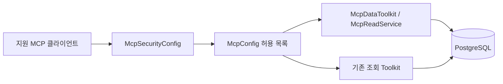

# Stock·Advice 원격 MCP

`https://api.hvy.kr/mcp` 는 개인용 API 키로 저장된 주식 데이터·판단·성과를 조회하는 Stateless Streamable HTTP 엔드포인트다. Boot 4.1.1·Spring AI 2.0.1을 유지한다. 실행·수집·판단 생성·삭제 도구와 프롬프트·채팅 원문은 공개하지 않는다.

## 설정과 배포

| 환경변수              | 기본값                              | 의미                                  |
|-----------------------|-------------------------------------|---------------------------------------|
| `MCP_ENABLED`         | `false`                             | 서버와 전용 보안 체인 활성화          |
| `MCP_API_KEY`         | 빈 값                               | 활성화 시 필수. 누락하면 기동 실패    |
| `MCP_ALLOWED_ORIGINS` | `https://hvy.kr,https://api.hvy.kr` | 쉼표로 구분한 정확한 Origin 허용 목록 |

키는 운영 비밀 저장소나 접근 제한된 환경 파일로 주입한다. MCP 자체는 `ADVISOR_ENABLED=false`, OpenAI·Slack 키가 없는 상태에서도 사용할 수 있다. 기존 애플리케이션의 PostgreSQL·Redis 설정은 필요하다. 별도 DB 테이블은 추가하지 않는다.

`deploy/mcp.env.example`, `deploy/compose.mcp.example.yml`의 환경변수 블록을 기존 서비스에 반영한다. Compose 서비스 이름은 운영 파일에 맞춘다. HTTPS 프록시 예시는 `deploy/nginx-mcp.example.conf`이며 실제 upstream과 포트를 맞춰야 한다.

1. 새 이미지/태그를 빌드하고 기존 배포 정의에 적용한다.
2. 키를 주입하고 `MCP_ENABLED=true`로 컨테이너를 재생성한다.
3. 프록시가 `/mcp`와 `Authorization`, `Content-Type`, `Accept`, `MCP-Protocol-Version`을 그대로 전달하는지 확인한다. Stateless 방식은 세션 ID가 필요 없다.
4. 인증 없는 POST가 401인지 확인한 후 아래 클라이언트에서 초기화·대표 조회를 실행한다.
5. 롤백은 `MCP_ENABLED=false`로 재생성한다.

허용되지 않은 Origin은 403, 키 누락·불일치는 401이다. Origin 없는 서버 간 호출은 키 인증으로 허용한다. 허용된 Origin의 OPTIONS는 키 없이 204다. API 키는 기존 관리자 JWT 인증을 대체하지 않는다.

## 연결

### Claude 웹

Customize → Connectors → Add custom connector에서 URL을 입력한다. Authentication은 `No sign in`, Request headers에 `Authorization: Bearer <MCP_API_KEY>`를 설정한다. 대화에서 커넥터를 활성화한다. 조직 계정은 소유자의 커넥터 등록 권한이 필요할 수
있다. [공식 연결 안내](https://support.claude.com/en/articles/11175166-get-started-with-custom-connectors-using-remote-mcp)

### Claude Code

실제 키를 명령어 기록에 직접 쓰지 말고 환경변수로 전달한다.

```sh
claude mcp add --transport http --scope user hvy-stock \
  https://api.hvy.kr/mcp --header "Authorization: Bearer ${MCP_API_KEY}"
```

`/mcp`에서 연결 상태를 확인한다. 명령어가 해석한 헤더 값은 클라이언트 설정에 저장되므로 해당 파일을 공유하지 않는다. [공식 MCP 문서](https://code.claude.com/docs/en/mcp)

### Codex

Codex를 시작하는 프로세스에 `MCP_API_KEY` 환경변수를 주입한다.

```sh
codex mcp add hvy-stock --url https://api.hvy.kr/mcp \
  --bearer-token-env-var MCP_API_KEY
```

또는 사용자 설정에 다음을 추가한다.

```toml
[mcp_servers.hvy-stock]
url = "https://api.hvy.kr/mcp"
bearer_token_env_var = "MCP_API_KEY"
tool_timeout_sec = 15
```

키 자체가 아닌 환경변수 이름을 저장한다. [공식 MCP 설정](https://developers.openai.com/codex/mcp). ChatGPT 웹 직접 연결은 이번 제공 범위에서 제외한다.

## 조회 순서와 도구

`dataFreshness` → `dataGuide(topic="stock"|"advice"|"catalog")` → `resolveStock` → 필요한 데이터 조회 순으로 사용한다. 가이드 리소스 `stock://guide`, `advice://guide`, `stock://catalog`도 동일하게 제공한다.

| 영역        | 도구                                                                                                           |
|-------------|----------------------------------------------------------------------------------------------------------------|
| 종목 요약   | `resolveStock`, `stockSnapshot`, `priceSeries`, `metricTopN`, `newsHeadlines`, `stockMaster`                   |
| 종목 이력   | `stockSeries`, `stockFinancials`, `stockCorporateActions`, `stockSectors`                                      |
| 시장        | `marketOverview`, `marketTrend`, `marketRegime`, `globalLink`, `marketSeries`                                  |
| 저장 판단   | `latestAdvice`, `horizonPicks`, `compareAdvice`, `adviceChecks`, `listAdvices`, `adviceDetail`, `adviceScores` |
| 정량·성과   | `screeningTop`, `performanceSummary`, `advicePerformance`, `morningPerformanceComparison`, `signalIc`          |
| 가중치·교훈 | `adviceWeights`, `activeAdviceWeights`, `adviceLessons`, `adviceNotes`                                         |
| 안내        | `dataFreshness`, `tradingDays`, `dataGuide`                                                                    |

`screeningTop`은 저장 데이터로 정량 순위를 계산하며 새 판단을 저장하거나 LLM을 호출하지 않는다. 모든 도구는 readOnly=true, destructive=false, idempotent=true, openWorld=false 힌트를 갖는다.

| 시계열                                                           | type                                                                                                                |
|------------------------------------------------------------------|---------------------------------------------------------------------------------------------------------------------|
| `stockSeries(ticker, type, from?, to?, limit?, cursor?)`         | `PRICE`, `RAW_PRICE`, `METRIC`, `VALUATION`, `INVESTOR`, `MARKET_STAT`, `ETF_NAV`, `MASTER_HISTORY`, `ADJUST_EVENT` |
| `marketSeries(type, code, from?, to?, source?, limit?, cursor?)` | `INDEX`, `INDEX_METRIC`, `BREADTH`, `MARKET_INVESTOR`, `SECTOR`, `GLOBAL`, `MACRO`, `EVENT`                         |

예시 도구 인수:

```json
{
  "name": "stockSeries",
  "arguments": {
    "ticker": "005930",
    "type": "PRICE",
    "from": "2026-01-01",
    "to": "2026-03-31",
    "limit": 50
  }
}
{
  "name": "listAdvices",
  "arguments": {
    "kind": "H20",
    "variant": "LIVE"
  }
}
{
  "name": "adviceDetail",
  "arguments": {
    "adviceId": 123
  }
}
{
  "name": "advicePerformance",
  "arguments": {
    "kind": "DAILY",
    "horizon": 5
  }
}
{
  "name": "morningPerformanceComparison",
  "arguments": {}
}
{
  "name": "activeAdviceWeights",
  "arguments": {
    "horizon": 20
  }
}
```

`advicePerformance` 기본값은 최근 90일·DAILY·그 종류의 설정 호라이즌이다. `activeAdviceWeights`는 날짜 제한 없이 현재 활성 세트를 반환한다. 활성 세트가 없으면 `active=null`이다.

## 응답과 해석

MCP 도구 결과는 JSON `structuredContent`와 동일한 JSON 텍스트를 제공한다. 입력 형식 오류는 `bad_argument`, ID 미존재는 `not_found`, SQL 시간 초과는 `timeout`, 내부 실패는 `internal`이다. MCP 프로토콜/JSON Schema 위반은 SDK 수준 오류로 반환될 수 있다. 빈 목록과
미채점은 정상 결과이며, 과거 Slack 도구의 `no_data`는 MCP에서 빈 `items`와 `status=no_data`로 변환한다.

새 시계열·이력 목록은 기본 50건, 최대 250건이다. 날짜·고유키 오름차순의 `nextCursor`를 **같은 기간과 필터**로 재전달하고 null이면 끝이다. 재사용 시 필터가 다르거나 커서가 깨졌으면 거부한다. 기존 요약·랭킹 도구는 도구 설명에 명시된 고정 상한을 유지한다. 상세 판단은 저장된 후보·픽·점검을 묶어 반환한다.

- 날짜는 `yyyy-MM-dd`. 잘못된 날짜를 오늘로 대체하지 않는다.
- `requestedAsOf`: 명시적으로 요청한 기준일. `queryTo`: 미래를 오늘 (KST)로 제한한 조회 상한. `dataAsOf`: 실제 관측일 또는 데이터별 관측일. 페이지의 `dataAsOf`는 그 페이지 마지막 날짜다.
- `PRICE`의 `adj_*`는 수정가격 (원)·수정거래량 (주), `raw_close`·`raw_volume`은 원종가·원거래량이다. 전체 원 OHLC는 `RAW_PRICE`를 사용한다.
- 수익률 `ret_*`, 거리 `dist_*`, 성과 `excessRet`은 비율 (0.01=1%). % 단위 컬럼은 2026-10-16 부터 응답 키에 `_pct` 접미가 붙는다(`change_rate_pct`·`prtt_rate_pct`·`bench_rate_pct`·`avg_change_rate_pct`·`disparity_rate_pct`·`foreign_hold_rate_pct`, `McpFields` 의 `col AS alias` — DB 컬럼명은 그대로). 재무 비율은 % (1=1%). 시총·종목 수급 금액은 원, 재무 금액은 백만원, 시장 수급 금액은 원(KIS 백만원 ×1e6)·수량은 천주다.
- 재무는 `available_from`과 `first_seen_at` KST 날짜가 모두 상한 이하인 행만 제공한다. 거시는 `available_from<=to`, `obs_date<to`를 적용한다. 당시 정정 전 버전까지 완벽하게 재현하지는 않는다.
- EVENT는 완결된 UTC 관측일만 제공하고 기본 LIVE다. BACKFILL은 명시적으로 지정한다.
- 수정계수는 현재 뷰 기준이며 과거 당시의 계수 버전을 보장하지 않는다. 섹터·시장 폭은 현재 구성에 따른 재현 한계가 있다.
- DAILY·MORNING·H20·H60·H180을 서로 대체하지 않는다. 0픽은 관망, 채점 없음은 미채점이다. H60/H180의 판정 제한과 표본 수를 함께 읽는다.

## 구현과 검증



`McpConfig`는 읽기 전용 트랜잭션에서 PostgreSQL `SET TRANSACTION READ ONLY`, SQL 5초 제한, 트랜잭션 10초 제한을 적용한다. 서버 요청 제한도 10초로 설정한다. `McpFields`의 명시적 투영 필드와 `McpAdviceHeader` DTO가 DB/도메인 변경에 따른 자동 공개를 막는다. 로그에는
도구명·처리시간·결과 상태·traceId만 남긴다.

```sh
./gradlew test --tests 'kr.hvy.blog.modules.mcp.*' \
  --tests 'kr.hvy.blog.modules.advisor.application.chat.tool.*Test'
```

Colima 환경에서는 `DOCKER_HOST=unix://$HOME/.colima/default/docker.sock`, `TESTCONTAINERS_DOCKER_SOCKET_OVERRIDE=/var/run/docker.sock`를 함께 지정한다. `McpHttpTest`는 실제 SDK 초기화·도구·리소스·인증·Origin·OPTIONS,
`McpReadPgTest`는 PostgreSQL 페이지·시점 조건·쓰기 거부·필드 노출, `McpApplicationTest`는 실제 앱 구성과 관리자 인증을 검증한다.

운영 완료 확인은 지원 클라이언트에 운영 URL을 등록하고 `dataFreshness`, `stockSeries`, `listAdvices`, `advicePerformance`를 성공적으로 호출하는 것이다. 로컬 테스트 통과만으로 운영 배포 완료를 의미하지 않는다.
